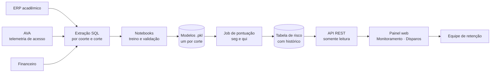

<div align="center">

# Previsão de Evasão — Graduação

**Machine learning que ordena, todo mês, os alunos com maior risco de não se rematricular,
e entrega essa fila para a equipe de retenção agir.**


Graduação **Presencial** · **EAD** · **Híbrida**

</div>

---

## Visão geral

O projeto vai do dado bruto até a tela usada pela equipe de retenção:



| Etapa | Onde está |
|---|---|
| Treino e validação dos modelos | [`ml/`](ml/) |
| Pontuação periódica e gravação da fila | [`job/`](job/) |
| API de consulta da fila | [`api/`](api/) |
| Painel web (front + backend) | sistema interno, fora deste repositório ([detalhes abaixo](#do-modelo-à-tela)) |
| Decisões de modelagem e o que as justificou | [`METODOLOGIA.md`](METODOLOGIA.md) |

---

## Os modelos

Um conjunto de modelos **por modalidade**, porque cada uma tem seu próprio calendário
(semestre no presencial, trimestre no EAD e no híbrido), e todo o cálculo de período
depende disso.

Dentro de cada modalidade, **um modelo por corte**: o mesmo aluno é fotografado em
momentos diferentes do período, e cada modelo só enxerga o que existia até aquela data.
Assim a equipe recebe uma fila nova ao longo do período, não só no fim.

| Modalidade | Calendário | Cortes | Notebook |
|---|---|---|---|
| **Presencial** | semestral | 5 — um por mês letivo (31/08 → 31/12) | [`grad-presencial-mensal/`](ml/grad-presencial-mensal/) |
| **EAD** | trimestral | 3 — +30 dias, +60 dias e fechamento | [`grad-ead/`](ml/grad-ead/) |
| **Híbrida** | trimestral | 3 — +30 dias, +60 dias e fechamento | [`grad-hib/`](ml/grad-hib/) |

**Por que um modelo por corte, e não um só?** Foi medido. Um modelo único, treinado com
as cinco fotografias empilhadas e o mês como feature, perdeu em 4 dos 5 cortes. O mesmo
valor muda de sentido ao longo do período: 10 dias ativos no AVA é bom no mês 1 e péssimo
no mês 5.

### Resultado — Presencial

Evasores reais entre os **200 primeiros da fila** (probabilidade *out-of-fold*), contra a
melhor regra de uma coluna só (dias sem acessar o AVA) e contra o acaso:

| Mês | Corte | Modelo | Regra de 1 coluna | Acaso | Ganho sobre a regra |
|:-:|:-:|:-:|:-:|:-:|:-:|
| 1 | 31/08 | **123** | 78 | 23 | **+45** |
| 2 | 30/09 | **168** | 136 | 24 | **+32** |
| 3 | 31/10 | **180** | 150 | 24 | **+30** |
| 4 | 30/11 | **192** | 162 | 24 | **+30** |
| 5 | 31/12 | **195** | 166 | 24 | **+29** |

O modelo rende mais justamente quando há menos dado: no primeiro mês, antes de o aluno
"sumir", ele encontra 45 evasores a mais que a regra.

---

## Como foi feito

### Métricas
O modelo serve para **ordenar uma fila** do tamanho que a equipe consegue abordar. As
métricas, em ordem de peso:

1. **`recall@200`**: dos evasores reais, quantos caem nos 200 primeiros
2. **`recall@10%`**: o mesmo, comparável entre modalidades de tamanhos diferentes
3. **PR-AUC**: qualidade geral do ranking
4. **`precision@K`**: quanto do esforço da equipe vai para quem de fato evadiria

### Features
Cada bloco é calculado **só com o que existia até a data do corte**:

- **Acadêmico:** notas, frequência, aprovação e reprovação por falta no período anterior
- **AVA:** dias ativos, dias desde o último acesso, sessões por dia, desaceleração recente
- **Financeiro** (presencial e EAD): situação de pagamento por data de vencimento
- **Perfil:** curso (com códigos equivalentes unificados) e município, com a cauda longa agrupada

Nulo em coluna de período **não é imputado**: ali ele significa "não cursou nada", que é
informação. Gênero e raça **não entram** no modelo; são usados apenas na auditoria de viés.

### Modelo
`RandomForestClassifier` sensível a custo (`class_weight`), com tratamento nativo de
`NaN`. O ganho de cada mudança foi medido no pipeline real, nunca num modelo de teste.

### Validação
- **Origem deslizante** (EAD e híbrido): treina nas coortes até *t*, testa na coorte
  *t+1*, do jeito que o modelo é usado em produção.
- **Out-of-fold** (presencial): todo aluno recebe a nota de um modelo que não o viu. Um
  split aleatório 80/20 superestimava o recall em **38 pontos**.
- **Regra de uma coluna como adversário**: só vai para produção o corte que supera
  "ordenar por dias sem acessar o AVA" por margem fora do ruído. No EAD e no híbrido,
  o corte de +60 dias empatou e ficou de fora.

### Caça ao vazamento
Boa parte do trabalho foi encontrar features que liam o futuro. Alguns casos, com
números, em [`METODOLOGIA.md`](METODOLOGIA.md):

- um `INNER JOIN` com o AVA que descartava **607 evasores**, justamente quem nunca acessou;
- uma feature financeira que lia **pagamentos feitos depois do corte**;
- um filtro de elegibilidade sem data que escondia **834 formandos rotulados como evasores**.

> Se uma feature de risco aparece *protegendo* o aluno, o corte de data está errado.

### Faixas de risco
As faixas saem da **posição na fila**, não da probabilidade, porque os modelos não são
calibrados:

| Faixa | Fatia da fila | Evasão observada | Abordagem |
|---|---|---|---|
| 🔴 **Crítica** | ~2% do topo | ~41% | contato humano individual |
| 🟠 **Alta** | até 10% do topo | ~25% | mensagem ativa no WhatsApp, com transbordo humano |
| 🟡 **Média** | de 10% a 20% | ~16% | acompanhamento |

*Presencial, média dos 5 cortes; a evasão média da base é ~8%.*

Cada aluno da fila vem com **motivos em texto** ("aprovou 40% das disciplinas do período
anterior"). Os números dentro das frases foram conferidos contra o banco: 781 pares,
zero divergência.

---

## Do modelo à tela

### Job de pontuação — [`job/`](job/)
Roda às segundas e quintas. Para cada modalidade: extrai a base do dia, escolhe o modelo
do corte vigente, monta o `X` exatamente como no treino, ordena, calcula as faixas e
grava a fila numa tabela com histórico. Só as três faixas são gravadas: estar fora da
tabela significa "sem risco".

### API de consulta — [`api/`](api/)
Camada **somente leitura** sobre a tabela de risco. Não roda modelo e não grava nada; se
o job atrasar, ela continua servindo a última fila e avisa em `fila_atualizada: false`.

| Rota | O que entrega |
|---|---|
| `/{modalidade}/alunos/listar` | alunos em risco, com filtro por curso e faixa |
| `/{modalidade}/alunos/consultar?ra=` | situação de um aluno e os motivos do risco |
| `/{modalidade}/fila/resumo` | contagem por curso e faixa |
| `/{modalidade}/fila/datas` | datas de fila disponíveis |
| `/{modalidade}/fila/saude` | se a fila está em dia |

`{modalidade}` é `presencial`, `ead` ou `hibrido`. A versão de produção é
[`api/grad-php/`](api/grad-php/), que unificou as três modalidades. As pastas por
modalidade e a versão em FastAPI ([`api/grad-presencial/`](api/grad-presencial/)) são
as etapas anteriores. Cada uma tem documentação OpenAPI e uma suíte de testes contra o
banco.

### Painel web
A API é consumida por um painel web que roda dentro do sistema interno da instituição,
com **front-end e backend próprios**. Esse código fica no repositório privado do
sistema e não é publicado aqui.

**Front-end:** React 19 · TypeScript · Vite · Tailwind CSS v4 · Motion

| Tela | O que faz |
|---|---|
| **Monitoramento** | fila do dia por faixa, % de risco por curso, saúde e histórico das filas |
| **Consulta por RA** | situação do aluno, motivos do risco, em quantas filas apareceu e alunos parecidos com ele |
| **Disparos** | envio de mensagem a um aluno da fila por push no app, e-mail ou WhatsApp |
| **Histórico** | o que foi disparado no dia |
| **Exportar** | fila e dossiê do aluno em Excel |

**Backend (PHP, no próprio sistema):**
- **login** pelo SSO da intranet, com lista de usuários autorizados e uma permissão a mais para a tela de Disparos;
- **proxy** para a API de evasão: o token da API é injetado no servidor e nunca chega ao navegador;
- contagem da base de alunos por modalidade e por curso, para calcular o % em risco;
- **disparos** para **um aluno ativo por vez**, com cada envio registrado para auditoria;
- respostas com dado pessoal sempre com `Cache-Control: no-store`.

---

## Estrutura

```
ml/
├── grad-presencial-mensal/   5 modelos, um por mês do semestre
├── grad-ead/                 3 modelos por trimestre (+ versão anterior, de corte único)
└── grad-hib/                 3 modelos por trimestre (+ versão anterior, consolidada)

job/
├── pontuar_presencial.py     pontua e grava a fila de cada modalidade
├── pontuar_ead.py
├── pontuar_hibrido.py
└── pontuar_todos.py          roda as três em sequência

api/
├── grad-php/                 API unificada (produção)
├── grad-presencial-php/      APIs por modalidade (antes da unificação)
├── grad-ead-php/
├── grad-hibrido-php/
└── grad-presencial/          versão em FastAPI
```

---

## Stack

**ML:** Python 3.12 · pandas · scikit-learn · LightGBM · CatBoost · Jupyter
**Dados:** SQL Server
**Serviço:** PHP 7.3+ · FastAPI
**Front-end:** React 19 · TypeScript · Vite · Tailwind CSS v4

---

## Dados

Este repositório tem **só o código**. As bases de alunos, as queries de extração e os
modelos treinados não são publicados: são dados pessoais e pertencem à instituição. Por
isso os notebooks e os jobs não rodam como estão; eles apontam para arquivos que
existem apenas no ambiente interno. Nomes de bancos e sistemas foram trocados por
genéricos.
